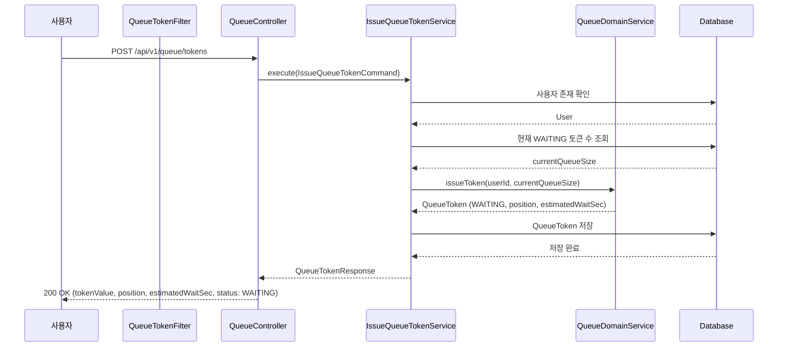
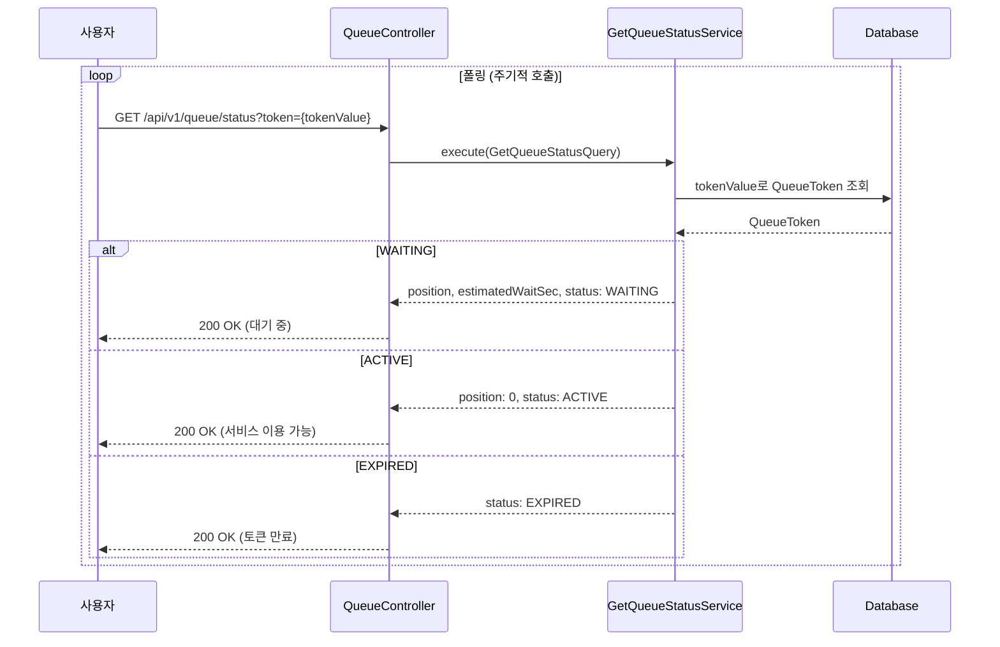
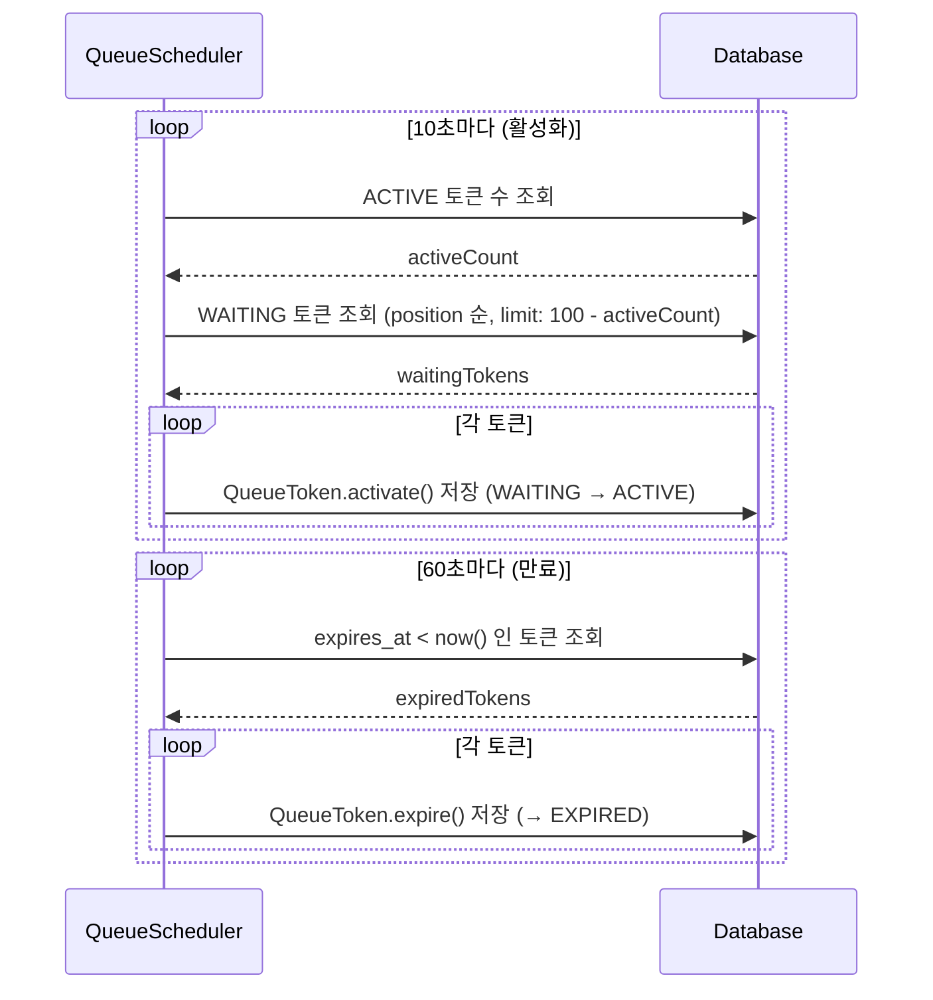
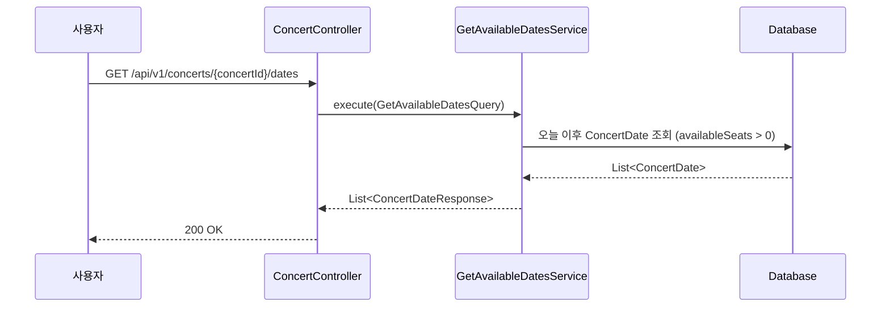
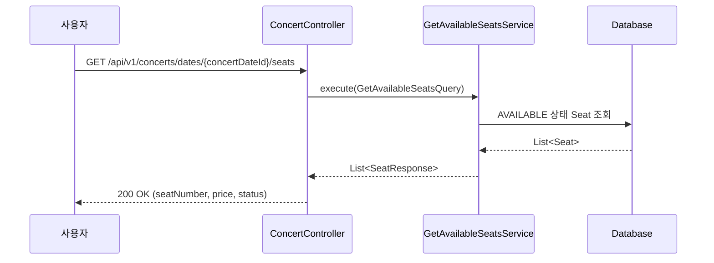
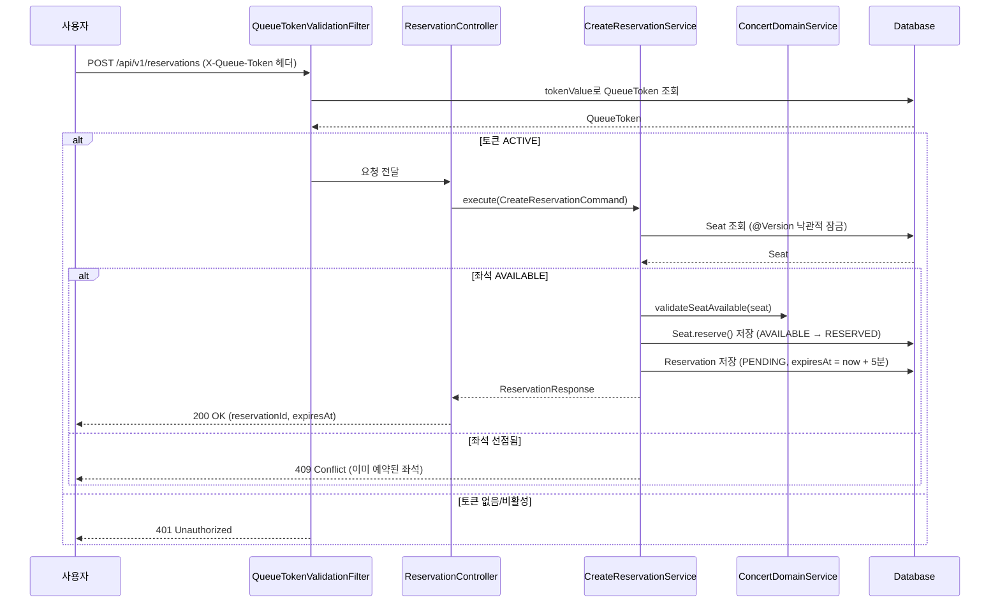
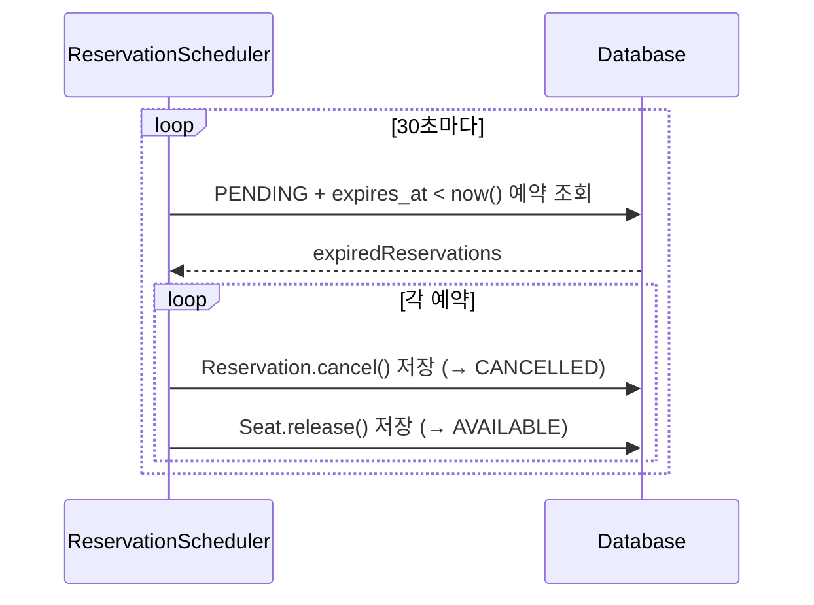
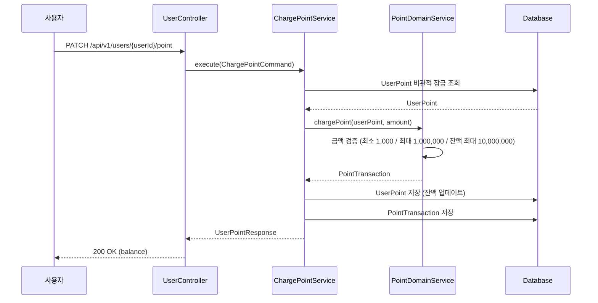
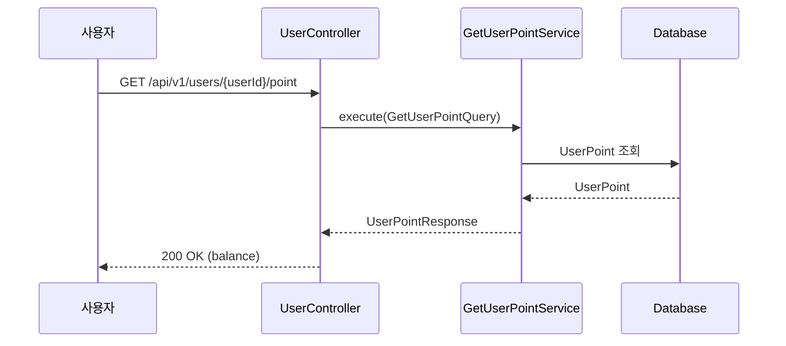
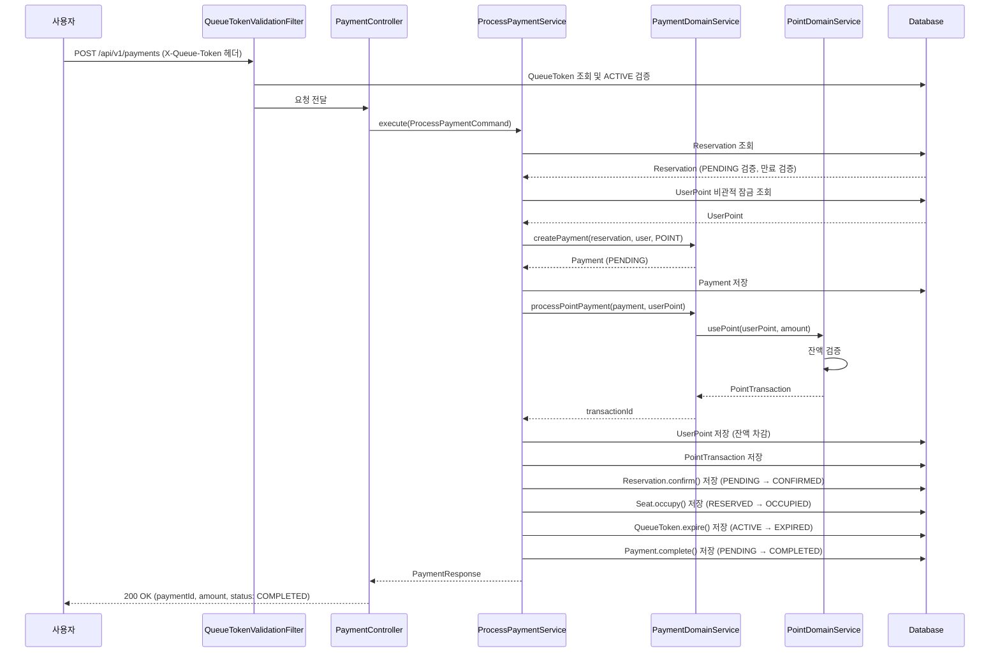

# 시퀀스 다이어그램

## 1. 유저 토큰 발급

- 토큰은 항상 WAITING으로 발급
- 스케줄러가 주기적으로 WAITING → ACTIVE 전환 (최대 동시 100명)

---

## 2. 대기열 상태 조회 (폴링)

---

## 3. 대기열 스케줄러 (자동 활성화 / 만료)

---

## 4. 예약 가능 날짜 조회

- 토큰 불필요

---

## 5. 예약 가능 좌석 조회

- 토큰 불필요

---

## 6. 좌석 예약 요청

- `X-Queue-Token` 헤더 필요 (ACTIVE 상태)
- 좌석 임시 점유 5분, 스케줄러가 만료 처리

---

## 7. 예약 만료 스케줄러

---

## 8. 잔액 충전

---

## 9. 잔액 조회

---

## 10. 결제

- `X-Queue-Token` 헤더 필요 (ACTIVE 상태)
- 포인트 차감 → 예약 확정 → 좌석 확정 → 토큰 만료

