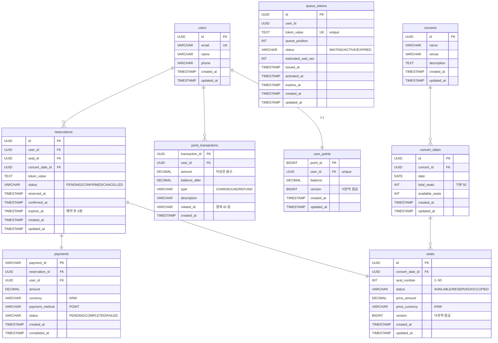

# ERD

---

## 주요 제약 조건

| 테이블 | 제약 |
|--------|------|
| seats | seat_number BETWEEN 1 AND 50 |
| user_points | balance >= 0 |
| concert_dates | available_seats >= 0 AND available_seats <= total_seats |
| queue_tokens | status IN ('WAITING', 'ACTIVE', 'EXPIRED') |
| reservations | status IN ('PENDING', 'CONFIRMED', 'CANCELLED') |
| payments | amount > 0 |

## 주요 인덱스

| 테이블 | 인덱스 | 목적 |
|--------|--------|------|
| queue_tokens | (status, queue_position) | 스케줄러 활성화 쿼리 |
| queue_tokens | (expires_at) | 만료 처리 쿼리 |
| queue_tokens | (token_value) | 토큰 검증 |
| seats | (concert_date_id, status) | 가용 좌석 조회 |
| reservations | (expires_at, status) | 만료 예약 스케줄러 |
| reservations | (user_id) | 사용자별 예약 조회 |
| point_transactions | (user_id, created_at) | 거래 내역 조회 |
